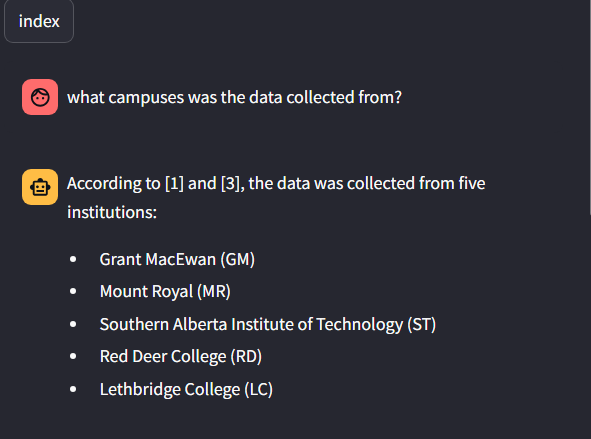
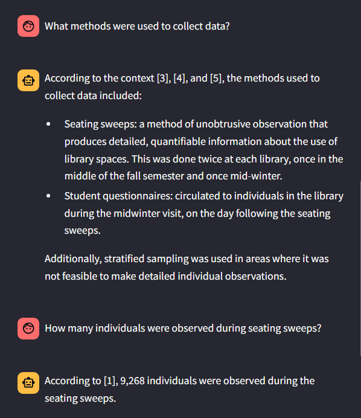
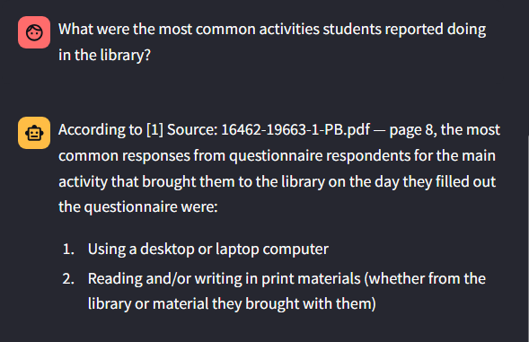
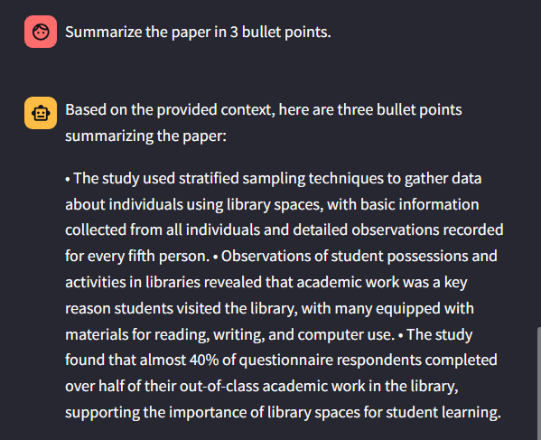

# AskThePaper — PDF RAG Assistant

AskThePaper is a local Retrieval-Augmented Generation (RAG) application that allows a user to upload a PDF and ask questions about its contents. The system extracts text from the uploaded document, splits it into searchable chunks, embeds those chunks into a vector database, retrieves the most relevant evidence for a user question, reranks the retrieved chunks with a cross-encoder, and uses a local LLM to generate a grounded answer with citations back to the source pages.

The goal of this project is to demonstrate an end-to-end AI application that combines document ingestion, semantic search, reranking, local LLM inference, API design, and an interactive user interface.

---

## Project Overview

Most LLMs do not have direct access to private or newly uploaded documents. AskThePaper solves this by using a RAG pipeline: instead of asking the model to answer from memory, the system first retrieves relevant sections from the uploaded PDF and then gives those sections to the LLM as context.

This allows the assistant to answer questions using the actual document content rather than relying on unsupported model knowledge.

Example use case:

1. Upload a PDF lecture, policy document, report, or paper.
2. Ask a question about the document.
3. Receive a concise answer grounded in retrieved PDF chunks.
4. View the source pages used to support the answer.

---

## Tech Stack

### Frontend

* **Streamlit**

  * Provides the web-based user interface.
  * Handles PDF upload, chat input, chat history, loading states, and source display.
  * Runs locally at `http://localhost:8501`.

### Backend

* **FastAPI**

  * Provides the backend API layer.
  * Exposes routes for health checks, PDF ingestion, and document question-answering.
  * Runs locally at `http://localhost:8000`.

* **Uvicorn**

  * ASGI server used to run the FastAPI backend during development.

### PDF Processing

* **pypdf**

  * Reads uploaded PDF files.
  * Extracts page-level text from each document.
  * Preserves page numbers so answers can cite the correct source pages.

### Chunking

* Custom Python chunking logic:

  * Splits extracted text into smaller chunks.
  * Preserves page metadata for citations.
  * Supports overlap so related context is not lost at chunk boundaries.
  * Handles page-by-page chunking to improve traceability.

### Embeddings

* **Sentence Transformers**

  * Converts text chunks and user questions into dense vector embeddings.
  * Current embedding model: `all-MiniLM-L6-v2`.
  * Embeddings allow the system to perform semantic search rather than relying only on exact keyword matching.

### Vector Database

* **ChromaDB**

  * Stores document chunks, embeddings, and metadata.
  * Uses persistent local storage under `capstone/chroma_store`.
  * Enables semantic retrieval of the most relevant chunks for a user question.
  * The current MVP supports one active uploaded PDF at a time by clearing old indexed chunks when a new PDF is uploaded.

### Reranking

* **Cross-Encoder Reranker**

  * Current reranker model: `cross-encoder/ms-marco-MiniLM-L-6-v2`.
  * After Chroma retrieves candidate chunks, the reranker scores each question/chunk pair more carefully.
  * This improves retrieval quality by prioritizing chunks that directly answer the user’s question.

### LLM

* **Ollama**

  * Runs a local LLM for answer generation.
  * Current model: `llama3.2:3b`.
  * The LLM receives the user question plus the top reranked chunks and generates a grounded answer with citations.
  * The prompt instructs the model to answer only from the provided document context.

---

## Architecture

```text
User
 ↓
Streamlit UI
 ↓
FastAPI Backend
 ↓
PDF Ingestion Pipeline
    - Save uploaded PDF
    - Extract page text
    - Chunk text
    - Generate embeddings
    - Store chunks in ChromaDB
 ↓
Retrieval Pipeline
    - Embed user question
    - Search ChromaDB
    - Retrieve top candidate chunks
 ↓
Reranking Pipeline
    - Score question/chunk pairs
    - Sort chunks by relevance
 ↓
LLM Generation
    - Build RAG prompt
    - Send context + question to Ollama
    - Return cited answer
 ↓
Streamlit displays answer + sources
```

---

## Core Features Implemented

* PDF upload through Streamlit.
* FastAPI backend with `/health`, `/ingest`, and `/chat` endpoints.
* Uploaded PDFs are saved locally and indexed.
* Page-level PDF text extraction using `pypdf`.
* Custom chunking with metadata preservation.
* Embedding generation using `all-MiniLM-L6-v2`.
* Persistent ChromaDB vector storage.
* Semantic retrieval over indexed PDF chunks.
* Cross-encoder reranking for improved relevance.
* Local LLM answer generation through Ollama.
* Citation-style answers using retrieved source chunks.
* Source page display in the Streamlit UI.
* Previous PDF chunks are cleared when a new document is uploaded to keep the app focused on the active PDF.

---

## How the RAG Pipeline Works

### 1. Ingestion

When a user uploads a PDF, the backend saves the file and passes it into the ingestion pipeline. The document is opened with `pypdf`, and text is extracted page by page. Each page is split into smaller chunks while preserving metadata such as filename, page number, and chunk number.

### 2. Embedding and Indexing

Each chunk is embedded using a Sentence Transformer model. The resulting vector, original text chunk, and metadata are stored in ChromaDB. This allows the app to search by meaning rather than only by exact words.

### 3. Retrieval

When the user asks a question, the question is embedded using the same embedding model. ChromaDB compares the question embedding against stored chunk embeddings and returns candidate chunks that are semantically similar.

### 4. Reranking

The initial retrieved chunks are passed to a cross-encoder reranker. Unlike the vector retriever, the cross-encoder reads the question and each chunk together, then assigns a relevance score. This helps prioritize chunks that directly answer the user’s question.

### 5. Answer Generation

The top reranked chunks are formatted into a context prompt and sent to the local LLM through Ollama. The model is instructed to answer only from the provided context and include citations such as `[1]`, `[2]`, etc.

---

## Example

Question:

```text
What is the power of static?
```

Answer:

```text
The power of static is to hide the "mess" and expose only a clean API. It encapsulates internal helpers, uses static for functions that are not part of the public interface, prevents namespace pollution, protects state, and encourages a clear interface versus implementation boundary. [1]
```

Source:

```text
L05_API_Contracts.pdf — page 11
```

---

## Current Project Status

This project currently functions as a working MVP of a PDF-based RAG assistant. The main end-to-end pipeline is complete:

```text
PDF upload → extraction → chunking → embedding → indexing → retrieval → reranking → LLM answer → citations
```

The current version is designed for local development and demonstration. It is not yet a production deployment.

---

## Known Limitations

* The current version supports one active PDF at a time.
* Streaming responses are not implemented yet; the app waits for the full LLM answer before displaying it.
* PDF extraction depends on `pypdf`, so scanned image-based PDFs may not work without OCR.
* The current vector store is ChromaDB, which is suitable for local development. A production version could use Qdrant, Elasticsearch, Pinecone, Weaviate, or pgvector.
* Out-of-scope handling is prompt-based in the current MVP. A stronger version would combine prompt instructions with a reranker-score threshold.
* The UI is functional but minimal and could be improved with better document status, confidence indicators, and cleaner citation handling.
* Evaluation is still manual and should be expanded with a test set of questions and expected source pages.

---

## Future Improvements

With more time, I would improve the project by adding:

* Streaming LLM responses in the Streamlit chat UI.
* A stronger out-of-scope guard using reranker confidence thresholds.
* Multi-document support with document selection.
* Token-aware chunking instead of character-based chunking.
* OCR support for scanned PDFs.
* A production vector database such as Qdrant or Elasticsearch.
* Docker Compose setup for FastAPI, Streamlit, and vector database services.
* Automated retrieval evaluation using test questions and expected citations.
* Better UI polish, including active document status and clearer source previews.
* Deployment to a cloud environment.

---

## Why This Project Matters

This project demonstrates more than a simple chatbot. It shows how to build an AI system that connects an LLM to external documents through retrieval, reranking, and grounded generation. The architecture reflects a practical pattern used in many real-world AI applications: use retrieval to find evidence, then use an LLM to turn that evidence into a useful answer.

The project combines backend engineering, frontend development, NLP, vector search, local LLM inference, and software design into one end-to-end application.


## Evaluation

I evaluated the AskThePaper RAG system using the uploaded PDF `16462-19663-1-PB.pdf`, an academic article titled *Using and Experiencing the Academic Library: A Multisite Observational Study of Space and Place*.

The document was indexed using token-based chunking. The embedding model generated 384-dimensional vectors for each chunk. The goal of this evaluation was to test whether the system could answer document-grounded questions, refuse unrelated questions, and handle factual, methodological, numeric, table-based, and summarization prompts.


### Test 1 — In-scope factual retrieval

Question: What campuses was the data collected from?

Expected: The system should identify the five institutions/campuses used in the study.

Actual: The system correctly returned Grant MacEwan, Mount Royal, Southern Alberta Institute of Technology, Red Deer College, and Lethbridge College.

Status: Pass

### Test 2 — Out-of-scope refusal

Question: Who is Cristiano Ronaldo?

Expected: The system should refuse to answer because the information is not in the uploaded document.

Actual: The system returned: “I don't know based on the provided document.”

Status: Pass

### Test 3 — Data collection methods

Question: What methods were used to collect data?

Expected: The system should identify seating sweeps, student questionnaires, and stratified sampling where needed.

Actual: The system correctly returned seating sweeps, student questionnaires, and stratified sampling.

Status: Pass

### Test 4 — Numeric retrieval

Question: How many individuals were observed during seating sweeps?

Expected: The system should return the total number of individuals observed.

Actual: The system correctly returned 9,268 individuals.

Status: Pass

### Test 5 — Table-heavy question

Question: What were the most common activities students reported doing in the library?

Expected: The system should retrieve the main reported activities from the relevant results/table section.

Actual: The system returned a related answer about desktop/laptop use and reading/writing print materials, but did not fully capture the broader Table 4 activity list.

Status: Pass

### Test 6 — Broad summarization

Question: Summarize the paper in 3 bullet points.

Expected: The system should produce a high-level summary of the whole paper.

Actual: The system produced a reasonable answer but focused too narrowly on methods and academic work, missing some broader themes from the abstract and discussion.

Status: Pass


### Summary of Evaluation

The system performed well on factual, methodological, numeric, and out-of-scope questions. It successfully retrieved and used relevant document evidence to answer questions about the study institutions, data collection methods, and number of observed individuals. It also correctly refused to answer an unrelated question about Cristiano Ronaldo, showing that the system can avoid unsupported answers when the information is not present in the uploaded document.

### Interpretation

These results show that the RAG pipeline is working for targeted document questions. The system can retrieve relevant chunks, rerank them, and generate grounded answers using a local LLM. However, the evaluation also shows that standard RAG retrieval can struggle when a question requires information from structured tables or requires a full-document summary.

### Current Strengths

* Correctly answers factual questions grounded in the PDF.
* Correctly handles numeric retrieval.
* Correctly identifies data collection methods.
* Correctly refuses unrelated out-of-scope questions.
* Uses retrieved context to generate citation-style answers.
* Demonstrates improved retrieval granularity through token-based chunking.


### Testcase evidence












#### Day 10 app-building tools

FastAPI = backend API framework.
Uvicorn = server that runs FastAPI.
Streamlit = frontend UI framework.
Pydantic-settings = clean way to manage config/settings.


#### to run FASTAPI 

Terminal 1:
- uvicorn capstone.api.main:app --reload --port 8000

Terminal 2:
- streamlit run capstone/ui/app.py


#### Big picture

FastAPI is running here:

http://localhost:8000

Streamlit will run here:

http://localhost:8501

So the architecture is:

User
↓
Streamlit UI
↓ HTTP request
FastAPI backend
↓
RAG pipeline later


#### What we have now: Capstone

PDF upload
↓
chunking
↓
embedding
↓
Chroma indexing
↓
retrieval
↓
reranking
↓
LLM answer
↓
citations#### Day 10 app-building tools

FastAPI = backend API framework.
Uvicorn = server that runs FastAPI.
Streamlit = frontend UI framework.
Pydantic-settings = clean way to manage config/settings.


#### to run FASTAPI 

Terminal 1:
- uvicorn capstone.api.main:app --reload --port 8000

Terminal 2:
- streamlit run capstone/ui/app.py


#### Big picture

FastAPI is running here:

http://localhost:8000

Streamlit will run here:

http://localhost:8501

So the architecture is:

User
↓
Streamlit UI
↓ HTTP request
FastAPI backend
↓
RAG pipeline later


#### What we have now: Capstone

PDF upload
↓
chunking
↓
embedding
↓
Chroma indexing
↓
retrieval
↓
reranking
↓
LLM answer
↓
citations